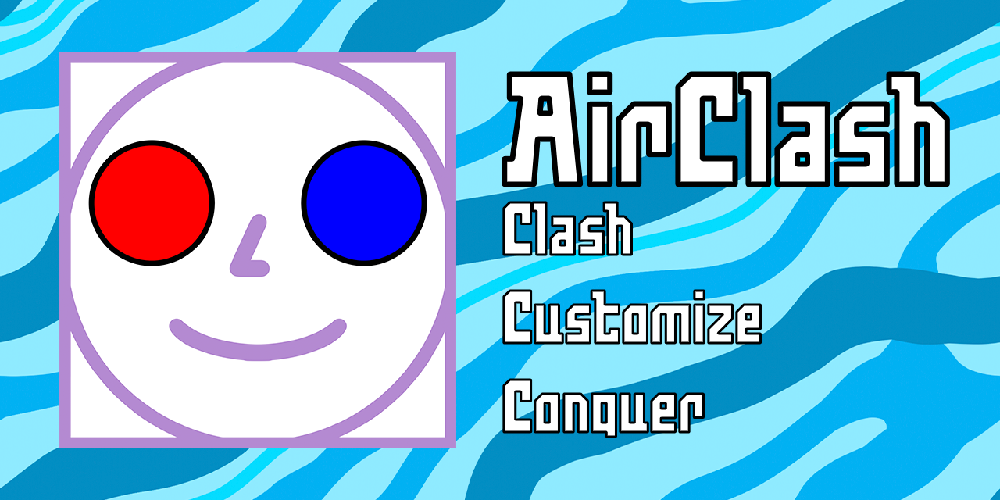
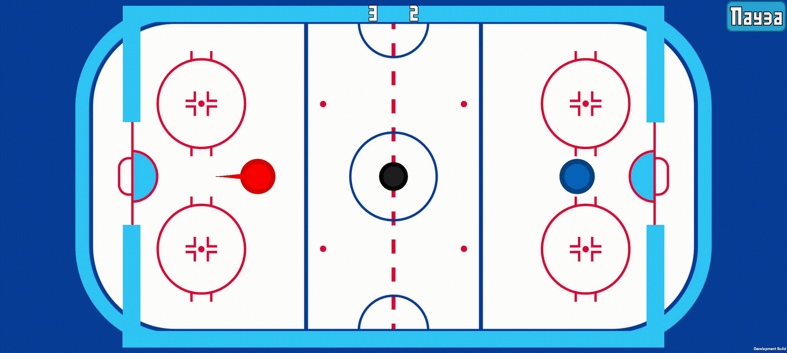

# 🎮 AirClash
**Fast-paced 2D Air Hockey Game with 1v1 & 2v2 Online Multiplayer, Progression System, Customization, and Dynamic Events**

 

🌐 **Language / Язык:** [**English**](README.md) | [**Русский**](README_ru.md)

 

[**Download Release**](#-installation--launch) • [**Community**](#-community--links) • [**Roadmap**](#-development-roadmap)

---

 

<h2 align="center">📸 Screenshots & Showcase</h2>

  

 

  
  &nbsp;&nbsp;
  
  &nbsp;&nbsp;
  

 

---

 

<h2 align="center">🌟 Key Features</h2>

 

### 🌐 Network Multiplayer & P2P
* **1v1 & 2v2 Competitive Matches**: Real-time multiplayer powered by Mirror and Epic Online Services (EOS). Includes 2v2 online multiplayer support (friendly matches).
* **Server-Side Elo Rating (MMR)**: Secure rating calculation on the Node.js/Firebase backend to prevent client tampering.
* **Lobbies, Friends & Global Leaderboards**: Automated matchmaking, private custom rooms, friend invites, and integrated global/regional leaderboards.
* **On-field Synchronization**: Advanced puck/paddle interpolation, real-time ping display, dynamic player nicknames, and custom skin synchronization on the field.

### 🤖 Advanced AI & Core Modes (Offline Mode)
* **4 Difficulty Levels**: `Easy`, `Medium`, `Hard`, and uncompromising `Extreme`.
* **Human-like Behavior**: Realistic misclicks, adaptive reaction time, and dynamic aggression adjustments based on match scores.
* **Interactive Main Menu & News**: Built-in main menu clicker mechanics and online news feed integration.

### 🎨 Customization, Economy & Minigames
* **Skins, Trails & Particles**: Unique paddle cosmetics, particle effects, and custom puck trails with individual sound design.
* **SoftMask UI Integration**: Translucent UI masking for crisp shop and menu visual presentation.
* **Multi-tier Roulette**: Normal, Epic, and Legendary item roulettes with distinct drop rates and reward animations.

### ⚙️ Match Modifiers & Event System
* **Dynamic Modifiers**: Toggle Wind, Fog, More Walls, Small Puck, and Small Players to scale coin multipliers.
* **Event System & Quests**: Active holiday/special event systems, daily & persistent quests with midnight auto-refresh, quest rerolls/purchasing, and achievement tracking.

### 💾 Cloud Saves, Profile & Q&A Settings
* **Firebase & JSON Architecture**: Robust cross-device cloud synchronization of player profile, stats, coins, and inventory via structured JSON local caching and data migration.
* **Account Management**: In-game account registration, password/nickname filtering, playtime tracking, and server-side account deletion.
* **Granular Settings**: Toggleable FPS counter, in-game console inspector, vibration/haptics adjustments, volume sliders, and 13:00 push notification reminders.

 

---

 

<h2 align="center">🛠️ Architecture & Tech Stack</h2>

 

| Technology | Purpose in Project |
| :--- | :--- |
| **Unity 2D** | Game engine, air hockey physics, and responsive adaptive UI. |
| **Mirror & EOS** | Networking stack for P2P multiplayer connection, lobbies, and sync. |
| **Node.js & Firebase** | Backend for server-side Elo validation, authentication, and cloud saves. |
| **DOTween** | Smooth UI animations, popups, and reward feedback loops. |
| **TextMeshPro & SoftMask** | Crisp typography and high-performance translucent UI masking. |
| **ParrelSync** | Real-time multiplayer testing within a single Unity Editor instance. |

 

---

 

<h2 align="center">📦 Installation & Launch</h2>

 

1. Navigate to the [**Releases**](../../releases) section of this repository.
2. Download the latest `.apk` build for Android devices.
3. Install the application on your mobile device or emulator.
4. Launch the game, customize your profile, and climb the global leaderboards!

 

---

 

<h2 align="center">📌 Development Roadmap</h2>

 

> **Current Stage:** 🚀 *v1.5.0 Stable Release, holiday event implementation, and preparation for v1.6.0.*

- [x] Full UI rework with TextMeshPro and SoftMask
- [x] Server-side Elo rating calculation and Firebase cloud saves
- [x] Daily rewards, event system, and renewable quest mechanics
- [x] 1v1 & 2v2 Online Multiplayer (Mirror + EOS) with Friends & Leaderboards
- [x] Main Menu Clicker & News system
- [x] Advanced match modifiers (Wind, Fog, Walls, etc.)
- [ ] Holiday events rollout (Current Active Focus)
- [ ] Preparation and feature integration for v1.6.0
- [ ] Monthly ranked seasons and seasonal competitive passes
- [ ] Expanded social clan & tournament systems

 

---

 

<h2 align="center">🤝 Community & Links</h2>

 

📢 [**Telegram**](https://t.me/airclash_dev) &nbsp; | &nbsp; 🎬 [**TikTok**](https://www.tiktok.com/@airclash_dev) &nbsp; | &nbsp; 🎮 [**Itch.io**](https://zebraaar.itch.io/airclash) &nbsp; | &nbsp; 🌐 [**Website**](https://zebrarsgames.github.io/AirClash) &nbsp; | &nbsp; ✉️ `zebrarsgames@gmail.com`

 

---

 

<h2 align="center">👨‍💻 Author</h2>

**Zebrar's Games** — *Concept, design, and full-cycle development.*

If you like this project, please consider giving it a **⭐ star** on GitHub!

