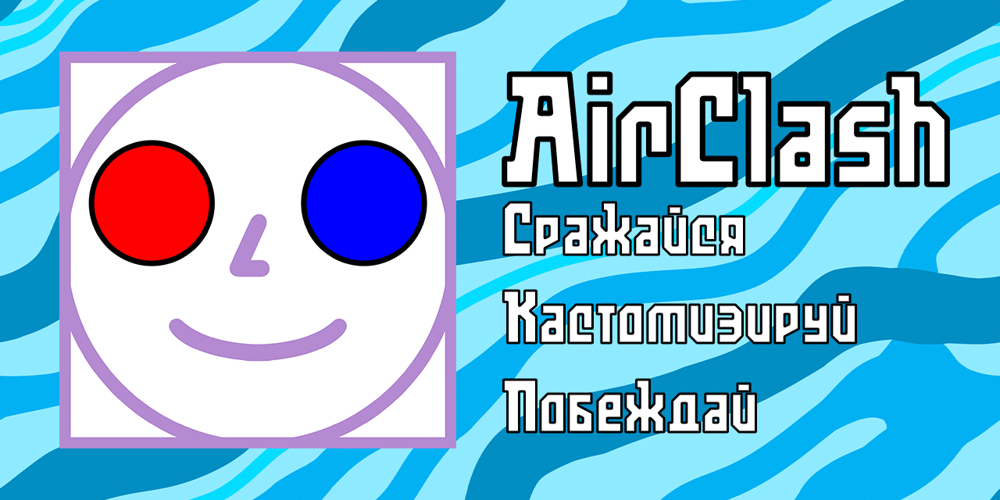
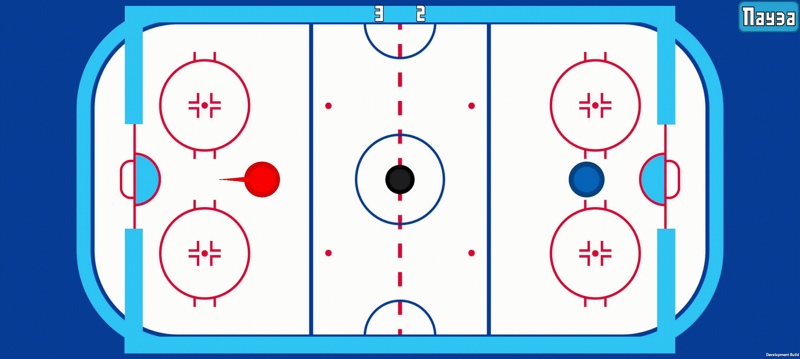

# 🎮 AirClash
**Динамичный 2D Аэрохоккей с Онлайн-Мультиплеером (1v1 и 2v2), Системой Прогресса, Кастомизацией и Ивентами**

 

🌐 **Language / Язык:** [**English**](README.md) | [**Русский**](README_ru.md)

 

[**Скачать релиз**](#-установка-и-запуск) • [**Сообщество**](#-сообщество-и-связь) • [**Планы разработки**](#-статус-и-планы-разработки)

---

 

<h2 align="center">📸 Скриншоты и Демонстрация</h2>

  

 

  
  &nbsp;&nbsp;
  
  &nbsp;&nbsp;
  

 

---

 

<h2 align="center">🌟 Основные Возможности</h2>

 

### 🌐 Сетевой Мультиплеер и P2P
* **Соревновательные матчи 1v1 и 2v2**: Сетевая игра с минимальной задержкой на базе Mirror и Epic Online Services (EOS), включая поддержку мультиплеера 2v2 (только дружеские матчи).
* **Серверный расчет ЭЛО (MMR)**: Защищенный подсчет рейтинга на стороне Node.js/Firebase бэкенда для предотвращения читерства.
* **Лобби, друзья и глобальные лидерборды**: Автоматический поиск соперников, приватные комнаты, система друзей и встроенные таблицы лидеров.
* **Синхронизация в реальном времени**: Интерполяция движения шайбы и бит, отображение пинга, передача никнеймов и актуальных скинов прямо на поле.

### 🤖 Продвинутый ИИ и Игровые Режимы
* **4 Уровня сложности**: `Easy`, `Medium`, `Hard`, `Extreme` с реалистичными ошибками, адаптивной реакцией и динамической агрессией.
* **Интерактивный кликер и новости**: Встроенный кликер в главном меню и система внутриигровых новостей.

### 🎨 Кастомизация, Экономика и Мини-игры
* **Скины, Трейлы и Частицы**: Уникальные визуальные стили бит, эффекты следов шайбы и индивидуальное звуковое сопровождение.
* **Интеграция SoftMask**: Четкое маскирование UI-элементов в магазине и интерфейсах меню.
* **Многоуровневая рулетка**: Обычная, эпическая и легендарная рулетки с разными шансами выпадения ценных предметов.

### ⚙️ Модификаторы и Система Ивентов
* **Матчевые Модификаторы**: Ветер, туман, дополнительные стены, уменьшенная шайба и уменьшенные игроки, дающие множители к получаемым монетам.
* **Система Ивентов и Квестов**: Активные праздничные/специальные ивенты, ежедневные и постоянные задания с полночным автосбросом, возможностью покупки/реролла квестов и трекингом достижений.

### 💾 Облачные Сохранения, Профиль и Настройки
* **Firebase и JSON архитектура**: Надежная синхронизация профиля, статистики, валюты и инвентаря между устройствами через JSON-кеширование.
* **Управление аккаунтом**: Регистрация, фильтрация нецензурных слов в никах, трекинг наиигранного времени (Playtime) и функция удаления аккаунта.
* **Гибкие настройки**: Переключаемый счетчик FPS, консоль разработчика, настройка вибрации (хаптики), регуляторы громкости и ежедневные пуш-уведомления в 13:00.

 

---

 

<h2 align="center">🛠️ Архитектура и Технологии</h2>

 

| Технология | Назначение в проекте |
| :--- | :--- |
| **Unity 2D** | Игровой движок, физика аэрохоккея и адаптивный UI. |
| **Mirror & EOS** | Сетевой стек для P2P соединения, лобби и синхронизации. |
| **Node.js & Firebase** | Бэкенд для серверной валидации ЭЛО, авторизации и облачных сохранений. |
| **DOTween** | Плавные UI-анимации, всплывающие окна и отклик на награды. |
| **TextMeshPro & SoftMask** | Четкая типографика и производительное мягкое маскирование UI. |
| **ParrelSync** | Тестирование мультиплеера внутри одного Unity Editor в реальном времени. |

 

---

 

<h2 align="center">📦 Установка и Запуск</h2>

 

1. Перейдите в раздел [**Releases**](../../releases) текущего репозитория.
2. Скачайте последнюю версию `.apk` файла для Android.
3. Установите приложение на ваше мобильное устройство или эмулятор.
4. Запустите игру, настройте профиль и поднимайтесь на вершины глобального рейтинга!

 

---

 

<h2 align="center">📌 Статус и Планы Разработки</h2>

 

> **Текущий этап:** 🚀 *Релиз версии 1.5.0, создание праздничных ивентов и подготовка к обновлению 1.6.0.*

- [x] Полная переработка UI на TextMeshPro и SoftMask
- [x] Серверный расчёт рейтинга ЭЛО и облачные сохранения Firebase
- [x] Ежедневные награды, система ивентов и обновляемые квесты
- [x] Мультиплеер 1v1 и 2v2 (Mirror + EOS) с друзьями и таблицей лидеров
- [x] Кликер в главном меню и система новостей
- [x] Настраиваемые модификаторы матча (ветер, туман, стены)
- [ ] Внедрение и запуск праздничных ивентов (Текущий фокус)
- [ ] Подготовка и разработка фич для версии 1.6.0
- [ ] Ежемесячные рейтинговые сезоны и праздничные сезоны
- [ ] Расширенная система кланов и турниров

 

---

 

<h2 align="center">🤝 Сообщество и Связь</h2>

 

📢 [**Telegram**](https://t.me/airclash_dev) &nbsp; | &nbsp; 🎬 [**TikTok**](https://www.tiktok.com/@airclash_dev) &nbsp; | &nbsp; 🎮 [**Itch.io**](https://zebraaar.itch.io/airclash) &nbsp; | &nbsp; 🌐 [**Website**](https://zebrarsgames.github.io/AirClash) &nbsp; | &nbsp; ✉️ `zebrarsgames@gmail.com`

 

---

 

<h2 align="center">👨‍💻 Автор</h2>

**Zebrar's Games** — *Идея, дизайн и разработка полного цикла.*

Если вам нравится проект, не забудьте поставить **⭐ звезду** репозиторию!

